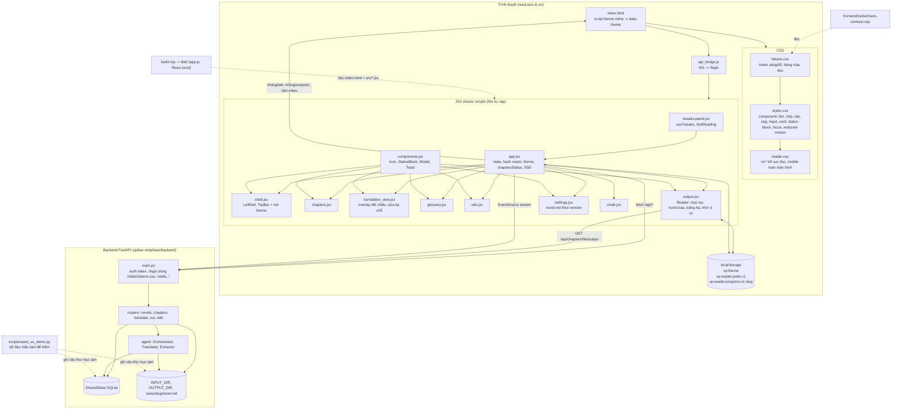

# T-950d2566: Nâng cấp UX/UI VietPhase: review, đề xuất rồi nâng cấp — ưu tiên trải nghiệm ĐỌC truyện (read.aico.io.vn)

Lần code: 2. File do aico tạo, cập nhật mỗi lần code.

## Đầu việc

| Id | Việc | Vai trò | Được sửa | Chờ | Kết quả |
| --- | --- | --- | --- | --- | --- |
| W1 | Rà soát 7 màn theo Nielsen, nghiên cứu ngắn, viết tài liệu nâng cấp UX/UI | coder | `qidian-vietphase/docs/ux/nang-cap-ux-ui.md` | - | xong (cursor) |
| W2 | Design tokens sáng/tối, style toàn cục, component dùng chung, script kiểm tương phản | coder | `qidian-vietphase/frontend/tokens.css`, `qidian-vietphase/frontend/src/styles.css`, `qidian-vietphase/frontend/src/components.jsx`, `qidian-vietphase/frontend/tools/` | - | xong (codex) |
| W3 | Chế độ đọc: bố cục tập trung, tuỳ chỉnh, mục lục, trước/sau, nhớ vị trí, trạng thái tải/lỗi/rỗng | coder | `qidian-vietphase/frontend/src/output.jsx`, `qidian-vietphase/frontend/src/reader.css` | - | xong (claude) |
| W4 | Trang /login cùng phong cách app và script tạo dữ liệu mẫu để kiểm | coder | `qidian-vietphase/backend/main.py`, `qidian-vietphase/scripts/seed_ux_demo.py` | - | xong (claude) |
| W5 | Ghép khung app: hash route màn đọc, chaptersStatus, theme sáng/tối, shell dùng được bằng bàn phím | coder | `qidian-vietphase/frontend/src/app.jsx`, `qidian-vietphase/frontend/src/shell.jsx`, `qidian-vietphase/frontend/index.html` | - | xong (codex) |
| W6 | Áp hệ thống thiết kế cho các màn làm việc, sửa lỗi nặng còn lại, kiểm tổng và cập nhật tài liệu | coder | `qidian-vietphase/frontend/src/chapters.jsx`, `qidian-vietphase/frontend/src/translation_view.jsx`, `qidian-vietphase/frontend/src/glossary.jsx`, `qidian-vietphase/frontend/src/wiki.jsx`, `qidian-vietphase/frontend/src/settings.jsx`, `qidian-vietphase/frontend/src/cmdk.jsx`, `qidian-vietphase/docs/ux/nang-cap-ux-ui.md`, `qidian-vietphase/frontend/src/styles.css`, `qidian-vietphase/frontend/src/reader.css`, `qidian-vietphase/frontend/src/output.jsx`, `qidian-vietphase/frontend/src/app.jsx`, `qidian-vietphase/frontend/src/shell.jsx`, `qidian-vietphase/frontend/src/components.jsx`, `qidian-vietphase/frontend/tokens.css` | W1, W2, W3, W4, W5 | xong (claude) |
| FIX | Sửa theo góp ý: [review bởi codex] | coder | `**` | - | xong |

## Kế hoạch

# Kế hoạch T-950d2566: nâng cấp UX/UI VietPhase, ưu tiên đọc truyện

## 0. Bối cảnh đã đọc

- Repo **chưa có** `docs/architecture.md` và `docs/plans/`. Không có `docs/delivery/` nên ticket không thuộc sprint nào, không đối chiếu checklist (đúng như ticket ghi).
- **Quy tắc từ `AGENTS.md`:**
  - JSX là classic script dùng chung global scope. Hook đặt alias theo file, không import/export. Thứ tự `<script>` trong `index.html` là thứ tự phụ thuộc.
  - Không đổi `/api/*`, không thêm bước build cho dev.
  - Không cuộn ngang ở 360px, tôn trọng reduced-motion.
  - Tự kiểm bằng `npx --yes esbuild@0.24.0 --loader:.jsx=jsx <file>`, `node qidian-vietphase/frontend/build.mjs` và `uv run python -m compileall -q backend`.
- **Hiện trạng ảnh hưởng tới kế hoạch:**
  - `tokens.css` chỉ có nền tối ("Dark-only"). `styles.css` gọi thẳng `--gray-*` và `--indigo-*` ở nhiều chỗ. Muốn có giao diện sáng thì phải chuyển các chỗ đó sang token theo vai trò.
  - `--fg-5` (gray-600) trên nền `--gray-950` chỉ đạt khoảng 2.6:1, còn `--fg-4` khoảng 4:1. Cả hai trượt WCAG AA, mà chữ phụ ở màn đọc dùng chính hai biến này.
  - `output.jsx`:
    - Lỗi tải bị ghi vào `content`, nên sao chép hay tải .txt sẽ lấy luôn dòng lỗi.
    - Nút "Lọc" không làm gì. "Đã lưu ✓" hiện ở màn chỉ đọc.
    - Nút trước/sau không bao giờ bị vô hiệu hoá. Không có tuỳ chỉnh đọc, không nhớ vị trí.
    - Lần đầu mở vào chương mới nhất. Tách đoạn chỉ theo `\n\n`. Drop cap dùng `charAt(0)` nên có thể tách sai dấu tiếng Việt dạng tổ hợp.
    - **Ở ≤768px, sidebar mục lục bị `display:none`, tức điện thoại không có mục lục.**
  - `app.jsx`:
    - `parseHash` và listener `hashchange` mở overlay đối chiếu với **mọi** tab có số chương.
    - Khi đổi truyện, `chapters=[]` nên màn đọc báo nhầm "Chưa có chương nào được dịch" trong lúc đang tải.
  - `shell.jsx`: mục truyện trong rail là `div onClick`, bàn phím không tới được.
  - `styles.css`: không có quy tắc `prefers-reduced-motion`. `.input-field` đặt `outline:none`, `.icon-btn` trên mobile chỉ 34px.
  - `/login`: HTML inline trong `backend/main.py`, nền xám nhạt, không cùng phong cách app. `/static` không nằm dưới `/api/` nên trang login nạp được `/static/tokens.css` mà không cần token.
  - Trạng thái `done` lấy từ SQLite chứ không suy ra từ file. Vì vậy muốn kiểm tự động thì cần script tạo dữ liệu mẫu.
  - Bản prod (`build.mjs`) giữ nguyên thẻ `<link>` CSS và script inline không khớp regex dev. Thêm `reader.css` và script theme inline trong `<head>` vẫn chạy ở prod.

## 1. Quyết định cho các câu hỏi mở của BA

| Câu | Lựa chọn |
|---|---|
| Q1 | `#/<slug>/output/<n>` là chương đang đọc, **không** mở overlay. Overlay mở từ màn đọc dùng `#/<slug>/output/<n>/doi-chieu` (pushState, Back thì đóng overlay và về màn đọc). Các tab khác giữ hành vi cũ, ví dụ `#/<slug>/chapters/3` vẫn mở overlay. Chuyển chương khi đọc dùng `replaceState`. |
| Q2 | Có tiến độ thì mở tiếp chỗ đã đọc. Chưa có thì mở chương `done` đầu tiên. |
| Q3 | Trước/sau bỏ qua chương chưa dịch. Mục lục chỉ liệt kê chương `done`. |
| Q4 | Dấu nhỏ "chưa duyệt" chỉ hiện trong mục lục, kèm chữ để không phụ thuộc màu. |
| Q5 | Không thêm webfont mới. Font đọc có chân dùng `Noto Serif` (đã có trong `@import` của `tokens.css`, đủ tiếng Việt), dự phòng Georgia và Times New Roman. Font không chân dùng ngăn xếp hệ thống (`system-ui, "Segoe UI", Roboto, "Helvetica Neue", Arial`). Tweak `fontReading` vẫn là nguồn duy nhất cho lựa chọn có chân/không chân, và bảng "Aa" của màn đọc sửa cùng giá trị đó. Tài liệu ghi `@import` Google Fonts (không SRI được) là vấn đề để ticket sau (tự host). |
| Q6 | Lưu `{ num, filename, para, frac, at }`: `para` là chỉ số đoạn đầu tiên đang thấy, `frac` là tỉ lệ cuộn dự phòng. Khôi phục theo `para` trước. |
| Q7 | Cài đặt đọc dùng chung mọi truyện, lưu ở `vp:reader:prefs:v1`. |
| Q8 | Sáng/tối là theme cả app (`data-theme`, lựa chọn Hệ thống/Sáng/Tối, khoá `vp:theme`, mặc định theo hệ thống). Nền đọc có 4 lựa chọn: Theo giao diện / Sáng / Sepia / Tối. Sepia chỉ áp cho vùng đọc. |
| Q9 | Chấm **nặng** và sửa trong ticket: lỗi chèn vào nội dung, "Lọc" vô tác dụng, "Đã lưu ✓" sai nghĩa. "Phút đọc" giữ lại nhưng tính theo âm tiết/250 và bỏ "ký tự" (mức nhẹ). |
| Q10 | Mỗi dòng không rỗng là một đoạn (tách theo `\n`, bỏ dòng trống), xử lý được cả hai kiểu xuống dòng. Bỏ drop cap. |
| Q11 | Có ←/→ trong màn đọc. Không kích hoạt khi có modifier, khi đang ở `INPUT/TEXTAREA/SELECT/contenteditable`, hoặc khi overlay đang mở. |
| Q12 | Ưu tiên lỗi chặn luồng đọc và luồng sửa bản dịch. Phần còn lại ghi vào "Để ticket sau" kèm lý do. |

## 2. Hợp đồng giữa các đầu việc (để chạy song song)

**Token** (W2 viết vào `tokens.css`, W3/W4/W5/W6 dùng):
- `--bg-app`, `--bg-surface`, `--bg-elevated`, `--bg-input`, `--fg-1..5`, `--border*`, `--accent*`, `--success/warn/danger(-bg)` cho cả `:root` (tối) và `:root[data-theme="light"]`.
- `--focus-ring`, `--tap-min: 44px`, `--measure: 68ch`.
- `--font-reading-serif`, `--font-reading-sans`.
- `--reader-{light|sepia|dark}-{bg|fg|muted|border|accent}`.
- Thang bo góc, khoảng cách và chuyển động giữ tên hiện có.

**CSS component** (W2, trong `styles.css`):
- `.btn` (`primary`/`secondary`/`ghost`/`danger`, `.sm`), `.icon-btn`, `.chip`, `.tab-btn`, `.seg` (segmented), `.input-field`, `.card`, `.status-block`, `.skeleton`, `.sr-only`.
- `:focus-visible` toàn cục.
- Khối `@media (prefers-reduced-motion: reduce)` toàn cục.
- `@media (pointer: coarse)` nâng `.icon-btn`/`.btn.sm` lên ≥44px.
- W2 **xoá mọi rule `.reader*` cũ** trong `styles.css`, kể cả trong khối mobile. Màn đọc mới dùng tiền tố `rd-` trong `reader.css`.

**JSX dùng chung** (W2, `components.jsx`):
- `StatusBlock({ kind: "loading"|"error"|"empty", title, desc, actions })`.
- Icon mới: `sun`, `moon`, `monitor`, `type`, `menu`, `refresh`, `wifiOff`. `Icon` vẫn trả `null` nếu tên không có, nên thiếu icon không làm vỡ app.

**Props `OutputScreen`** (W3 viết, W5 truyền, W5 render với `key={currentSlug}` để đổi truyện là mount lại sạch):
`{ chapters, chaptersStatus: "loading"|"ready"|"error", onReloadChapters, novel, routeChapter /* string|null từ URL */, onReadChapter(num) /* app cập nhật hash bằng replaceState */, onOpen(ch) /* overlay */, onGoChapters(), onOpenRail(), suspendKeys /* overlay đang mở */, fontMode, onFontMode(v) }`.

**Khoá localStorage** (mọi truy cập bọc try/catch, giá trị hỏng thì dùng mặc định):
- `vp:theme`: `system|light|dark`.
- `vp:reader:prefs:v1`: `{ size 14–28, mặc định 18; lh ∈ {1.5,1.7,1.9,2.1}, mặc định 1.9; bg ∈ auto|light|sepia|dark }`.
- `vp:reader:progress:v1:<slug>`.

**Chế độ đọc mobile:** W5 đặt `data-reading="true"` cho `.app` khi `tab==="output"`. Trong `reader.css`, W3 ẩn `.topbar` và `.tabs` ở ≤768px khi có thuộc tính này. Màn đọc tự có thanh trên (☰ truyện, ‹ Chương, tiêu đề, Mục lục, Aa) và thanh dưới (‹ Trước | Mục lục | Sau ›, mỗi nút ≥44px). Hai thanh ẩn khi cuộn xuống, hiện lại khi cuộn lên hoặc chạm. Khi reduced-motion thì ẩn/hiện ngay, không trượt.

## 3. Các bước và file

**W1. Rà soát, nghiên cứu, viết tài liệu** (`qidian-vietphase/docs/ux/nang-cap-ux-ui.md`, file mới)
1. Đọc 7 màn (code và chạy thử headless nếu có thể) rồi lập bảng `Màn | Heuristic Nielsen | Mức (nặng/trung bình/nhẹ) | Mô tả | Hướng sửa | Trạng thái/Đầu việc`. Ghi sẵn các lỗi nặng đã thấy ở §0 và gán đầu việc sửa (W2/W3/W4/W5/W6).
2. Nghiên cứu ngắn: chế độ đọc của các app/web đọc truyện, nhớ vị trí, chỉnh cỡ chữ/giãn dòng/nền; công cụ dịch song ngữ đối chiếu theo đoạn. Ghi nguồn nếu tra được.
3. Viết các phần:
   - định hướng thị giác (màu, typography tiếng Việt, độ dài dòng, icon, chuyển động);
   - bảng design tokens đúng theo hợp đồng §2;
   - quy tắc component;
   - danh sách ưu tiên, đánh dấu "Làm trong T-950d2566" hoặc "Để ticket sau";
   - mục "Lỗi nặng đã sửa" để trống, W6 điền.

**W2. Tokens, style toàn cục, component dùng chung** (`frontend/tokens.css`, `frontend/src/styles.css`, `frontend/src/components.jsx`, `frontend/tools/check-contrast.mjs`)
1. `tokens.css`: thêm theme sáng, sửa `--fg-4/--fg-5` của theme tối để đạt ≥4.5:1, thêm các token trong §2 (gồm bảng màu đọc 3 nền).
2. `styles.css`:
   - thay tham chiếu `--gray-*`/`--indigo-*` trực tiếp bằng token theo vai trò;
   - đảm bảo `data-accent` vẫn đúng ở cả hai theme (`:root[data-theme="light"][data-accent=…]`);
   - thêm component class, `:focus-visible`, reduced-motion, vùng chạm cho thiết bị cảm ứng, `overflow-wrap:anywhere` cho các vùng văn bản;
   - xoá rule `.reader*` cũ.
3. `components.jsx`: thêm `StatusBlock` và các icon mới.
4. `tools/check-contrast.mjs`: script Node không phụ thuộc gói ngoài. Script đọc `tokens.css`, tính tỉ lệ tương phản cho các cặp chữ/nền đã khai báo (app sáng, app tối, 3 nền đọc, chữ phụ), và thoát mã ≠0 nếu có cặp <4.5. Đây là rào chắn cứng cho TC9: chạy tay được, không thêm vào build.

**W3. Chế độ đọc** (`frontend/src/output.jsx`, `frontend/src/reader.css` mới)
1. Bố cục: desktop có cột mục lục (thu gọn được) và cột đọc `max-width: var(--measure)`. Mobile đọc toàn màn hình, mục lục là drawer/bottom sheet đóng sau khi chọn, focus vào nút đóng, Esc đóng được.
2. Bảng "Aa" (popover, Esc đóng): cỡ chữ −/+, giãn dòng, nền 4 lựa chọn, kiểu chữ (`fontMode`/`onFontMode`). Đổi là áp ngay. Lưu bọc try/catch, có kiểm khoảng giá trị.
3. Điều hướng:
   - danh sách `done` sắp theo `chapter_num`;
   - trước/sau bỏ qua chương chưa dịch, nút ở đầu/cuối dùng `disabled` cùng `aria-disabled` và có kiểu hiển thị riêng;
   - cuối chương có khối "Chương sau ›" (hoặc "Đã hết chương đã dịch");
   - ←/→ theo luật Q11;
   - chuyển chương thì cuộn lên đầu và gọi `onReadChapter(num)`.
4. Chọn chương khi mount (sau khi `chaptersStatus==="ready"`):
   - có `routeChapter` hợp lệ thì mở chương đó;
   - `routeChapter` không có bản dịch hoặc không tồn tại: hiện `StatusBlock` "Chương này chưa có bản dịch" với nút "Mở mục lục" và "Đọc chương N gần nhất", không ghi đè tiến độ;
   - nếu không, có tiến độ thì mở chương đã nhớ; chương đã nhớ không còn `done` thì lặng lẽ chọn chương `done` gần nhất (lớn nhất ≤ số đã nhớ, nếu không có thì nhỏ nhất);
   - còn lại thì mở chương `done` đầu tiên.
5. Tải nội dung:
   - effect phụ thuộc `[filename, retryNonce]` để `done.length` đổi không gây tải lại;
   - dùng cờ `alive` để bỏ response cũ;
   - khi đổi chương thì xoá nội dung ngay và hiện `StatusBlock loading` hoặc skeleton;
   - lỗi lưu ở state riêng, hiện `StatusBlock error` có "Thử lại"; nếu `navigator.onLine===false` thì hiện thông điệp mất mạng; có sự kiện `online` thì tự thử lại;
   - nút sao chép và .txt vô hiệu khi đang tải hoặc lỗi.
6. Vị trí đọc: lắng nghe cuộn trên vùng cuộn thật (desktop là `.rd-body`, mobile là vùng cuộn tương ứng). Khoảng 400ms lưu một lần. Khôi phục sau khi nội dung render (`useLayoutEffect` tới đoạn `data-para`), chỉ khi chương mở ra là chương đã nhớ.
7. Dữ liệu đổi giữa chừng:
   - `done` thêm chương: mục lục cập nhật, chương sau tính lại, vị trí không đổi;
   - chương đang đọc rời khỏi `done` (dịch lại hoặc xoá): giữ nội dung đang hiện, kèm ghi chú nhỏ "Chương đang được dịch lại/không còn bản dịch".
8. Bỏ "Lọc", "Đã lưu ✓", drop cap. Đoạn văn có `overflow-wrap:anywhere`. Trạng thái rỗng (truyện chưa có chương dịch) có nút "Về danh sách chương" (`onGoChapters`). `chaptersStatus==="error"` thì hiện `StatusBlock` có "Thử lại" gọi `onReloadChapters`.
9. Toàn bộ vào ra localStorage gói trong các hàm nhỏ `rdLoad/rdSave` có try/catch, đặt tên riêng của file để không đụng global scope.

**W4. Trang /login và script dữ liệu mẫu** (`backend/main.py`, `scripts/seed_ux_demo.py` mới)
1. Chỉ sửa chuỗi `_LOGIN_HTML`:
   - `<link rel="stylesheet" href="/static/tokens.css">` cùng CSS inline nhỏ dùng token (thẻ, nút primary, ô nhập, focus ring, reduced-motion);
   - script inline đọc `vp:theme` (try/catch, fallback `prefers-color-scheme`);
   - `<label>` cho ô nhập, `autocomplete="current-password"`;
   - lỗi tiếng Việt "Token không đúng. Kiểm tra lại rồi thử lại." trong vùng `role="alert"`.
   
   Giữ nguyên route, mã 401/303 và cookie.
2. `scripts/seed_ux_demo.py --root <thư mục tạm>`:
   - đặt `INPUT_DIR`/`OUTPUT_DIR`/rules/DB vào `<root>` trước khi import `backend.config` (coder đọc `config.py`/`state.py` để lấy đúng biến);
   - tạo truyện A gồm 5 chương, chương 1, 2, 3, 5 `done` và có file bản dịch, trong đó có đoạn chỉ xuống dòng đơn và một dòng URL hoặc chuỗi chữ Hán dài không khoảng trắng;
   - tạo truyện B gồm 2 chương, chương 1 `done`;
   - có cờ `--mark-done 4` và `--unmark 3` để giả lập dữ liệu đổi giữa chừng;
   - từ chối chạy nếu `--root` là thư mục dữ liệu thật hoặc không trống mà thiếu `--force`.
   
   Không commit dữ liệu sinh ra.

**W5. Ghép khung app: router, theme, shell** (`frontend/src/app.jsx`, `frontend/src/shell.jsx`, `frontend/index.html`)
1. `index.html`:
   - thêm `<link href="/static/src/reader.css">` sau `styles.css`;
   - thêm script inline nhỏ trong `<head>` đặt `data-theme` trước khi render (try/catch, không phụ thuộc React);
   - đổi `<meta name="theme-color">` nếu thêm.
2. `app.jsx`:
   - `parseHash` đọc thêm `parts[3]`;
   - tab `output`: đoạn thứ ba thành `readerChapter`, chỉ mở overlay khi có `/doi-chieu`;
   - effect state→hash dựng `#/<slug>/output/<readerChapter>` hoặc `/<n>/doi-chieu` khi overlay mở trên tab đọc; tab khác giữ nguyên logic push/replace;
   - `pendingChapterRef` chỉ dùng cho overlay;
   - thêm `chaptersStatus` (reset khi đổi truyện, `ready`/`error` trong `loadChapters` có guard slug);
   - theme state cùng `matchMedia` listener;
   - `data-reading` trên `.app`;
   - render `<OutputScreen key={currentSlug} …/>` theo hợp đồng §2.
   
   **Giữ nguyên** guard `currentSlugRef`, confirm khi chuyển truyện lúc đang sửa dở, `navChapter`, logic 409.
3. `shell.jsx`:
   - mục truyện và "Tìm & lệnh" trong rail đổi thành `<button>`;
   - nút theme (Hệ thống/Sáng/Tối) trong TopBar, có `aria-label`;
   - tabs có `aria-current`; đổi nhãn tab "Bản dịch" thành "Đọc";
   - inline style dùng token.

**W6. Các màn còn lại, kiểm tổng, cập nhật tài liệu** (phụ thuộc W1–W5)
1. Áp component và token cho `chapters.jsx`, `translation_view.jsx`, `glossary.jsx`, `wiki.jsx`, `settings.jsx`, `cmdk.jsx`:
   - thay màu cứng trong inline style;
   - trạng thái rỗng/lỗi dùng `StatusBlock`;
   - phần tử bấm được phải là `button`/`a`;
   - sửa các lỗi **nặng** W1 ghi cho các màn này.
   
   **Không đụng** guard Esc/⌘←→ khi đang gõ, confirm bỏ bản sửa dở, luồng thêm thuật ngữ, upload, OCR.
2. Chạy toàn bộ kiểm tra §4 trên dữ liệu seed. Sửa lỗi phát hiện, kể cả trong file của W2/W3/W5 (các đầu việc đó đã xong nên không chồng lấn).
3. Cập nhật tài liệu: đánh dấu lỗi nặng đã sửa hoặc lý do chưa sửa, mục "Để ticket sau".

## 4. Cách kiểm tra (agent làm được)

**Tĩnh**
- esbuild cho mọi JSX đã sửa: `npx --yes esbuild@0.24.0 --loader:.jsx=jsx qidian-vietphase/frontend/src/<file>.jsx > /dev/null`.
- `node qidian-vietphase/frontend/build.mjs` chạy xong.
- `cd qidian-vietphase && uv run python -m compileall -q backend scripts`.
- `node qidian-vietphase/frontend/tools/check-contrast.mjs` thoát mã 0 (TC9).

**Chuẩn bị chạy**
1. `uv run python scripts/seed_ux_demo.py --root /tmp/vp-ux`.
2. Chạy uvicorn với env trỏ vào `/tmp/vp-ux`, một lần `DEV_MODE=true` và một lần bản prod sau `build.mjs` (TC33: console không lỗi).
3. Dùng trình duyệt headless ở 1280×800, 384×800, 360×740, mỗi khổ ở cả `data-theme` light và dark.

**Headless: luồng đọc**

| Kịch bản | TC |
|---|---|
| Đo `scrollWidth <= innerWidth` cho 7 màn (chương, overlay đối chiếu, đọc, thuật ngữ, Wiki, cài đặt, `/login`) | TC19, TC21 |
| Chụp màn đọc, đo độ rộng cột theo ký tự (60–80) | TC2 |
| Bấm sau/trước: 2→3→5, `scrollTop==0` | TC3, TC4 |
| Ở chương 1 và 5: nút có `disabled`, bấm không lỗi console | TC5 |
| Mục lục chọn chương 2; ở 384px drawer đóng; mục đang đọc có `aria-current` | TC6 |
| Có nút "Chương sau" ở cuối bài | TC7 |
| Đổi cỡ chữ, giãn dòng, nền rồi reload thì giữ nguyên | TC8 |
| Ghi đè `localStorage.setItem` cho ném lỗi rồi đổi cài đặt, chuyển chương: không trắng màn | TC10 |
| Đặt JSON hỏng hoặc `size: 999` rồi mở màn đọc: dùng mặc định | TC11 |
| Cuộn tới giữa chương 3, reload: đoạn đầu đang thấy lệch < 1 viewport | TC12 |
| A→B→A, có lúc bấm nhanh trong khi request chậm (route chặn/trễ): đúng truyện, đúng chương | TC13 |
| Truyện chưa đọc mở chương `done` đầu tiên | TC15 |
| `#/a/output/3` mở màn đọc, không có `.tv-overlay` | TC16 |
| `/output/4` và `/output/999` hiện StatusBlock | TC17 |
| `#/a/chapters/3` mở overlay | TC18 |
| Thanh đọc ở 384px: kích thước nút ≥44×44; `.topbar` và `.tabs` ẩn | TC20 |
| Tab và phím: duyệt bằng bàn phím, chụp viền focus; Esc đóng mục lục và bảng Aa | TC27 |
| `emulateMedia({reducedMotion:"reduce"})`: `transition-duration`/`animation-duration` tính ra ≈0 trên drawer/thanh đọc | TC28 |
| `/login` sai token hiện thông báo tiếng Việt, đúng token về `/` (đặt `API_TOKEN`) | TC29 |

**Headless: dữ liệu đổi giữa chừng**

| Kịch bản | TC |
|---|---|
| **Mất rồi xuất hiện lại:** đang nhớ chương 3, `--unmark 3` rồi mở tab đọc: mở chương 2, không lỗi. `--mark-done 3`, chọn chương 3 trong mục lục: đọc được | TC14 |
| **Chương đang đọc rời khỏi `done` giữa lúc đọc:** gọi lại `loadChapters` bằng cách đổi tab qua lại: nội dung giữ nguyên, có ghi chú | |
| **Số lượng đổi:** đang đọc chương 3 ở giữa trang, `--mark-done 4` rồi kích hoạt nạp lại chương: `scrollTop` không đổi, mục lục có chương 4, "Chương sau" trỏ chương 4 | TC25 |
| **Đổi truyện khi đang tải:** route `/api/chapters?…` trễ 2s, chuyển truyện liên tục: không lẫn nội dung | TC13 |
| **Offline:** `context.setOffline(true)` rồi chuyển chương: StatusBlock lỗi có "Thử lại", không còn nội dung cũ; sao chép và .txt bị vô hiệu. Bật lại mạng: tự tải lại hoặc "Thử lại" được | TC22, TC23 |
| **Lỗi API:** xoá file bản dịch rồi mở chương: StatusBlock lỗi, clipboard không chứa dòng lỗi | TC23 |
| **Truyện chưa có chương dịch:** empty state có nút về danh sách chương | TC24 |
| **Đang tải danh sách chương** (route trễ): hiện loading, không hiện "chưa có chương" | |

**Headless: hồi quy**

| Kịch bản | TC |
|---|---|
| Overlay đang gõ trong textarea, nhấn Esc và Ctrl+←/→: overlay vẫn mở, chương không đổi. Đóng bằng nút thì có confirm (bắt `dialog`) | TC30 |
| Settings: sửa file `novel.md` trên đĩa rồi lưu: có dialog 409, file không bị ghi đè | TC31 |
| Upload `.txt`, bôi đen để thêm thuật ngữ, mở OCR, bấm Dịch: chỉ kiểm request đi đúng route và payload như cũ (không cần API key) | TC32 |
| So nút, chip, ô nhập giữa các màn qua `getComputedStyle` (bo góc, cỡ chữ, màu theo token), chụp ảnh từng màn | TC26 |
| Đối chiếu file tài liệu với danh sách mục | TC1 |

## 5. Người duyệt tự kiểm (không phải điều kiện đạt)

- Đọc `qidian-vietphase/docs/ux/nang-cap-ux-ui.md`, đánh giá mức nặng và danh sách để sau.
- Trên điện thoại thật (iOS Safari, Android Chrome): đọc toàn màn hình, bấm một tay, thanh ẩn/hiện khi cuộn, safe-area/notch, vị trí đọc sau khi đóng hẳn trình duyệt.
- Mắt người: cảm giác chuyển động khi mở drawer/mục lục, thẩm mỹ 3 nền đọc, độ dễ đọc của font tiếng Việt trên màn thật.
- Trình duyệt thật: thanh tab, favicon, `theme-color`, chế độ riêng tư chặn storage, độ dài dòng khi zoom trình duyệt.
- Chạy theo hướng dẫn trong ticket: uvicorn `--port 9999`, mở 7 màn ở desktop và cửa sổ ~384px, sáng/tối.

```json
{"items": [
  {"id": "W1", "title": "Rà soát 7 màn theo Nielsen, nghiên cứu ngắn, viết tài liệu nâng cấp UX/UI", "role": "coder",
   "owns": ["qidian-vietphase/docs/ux/nang-cap-ux-ui.md"], "depends_on": [],
   "acceptance": "TC1: file có bảng vấn đề (Màn, Heuristic, Mức nặng, Mô tả, Hướng sửa, Đầu việc) đủ 7 màn (chương, đối chiếu, đọc, thuật ngữ, Story-Wiki, cài đặt, /login), gồm các lỗi nặng đã nêu trong kế hoạch (tương phản fg-4/fg-5, mobile không có mục lục, lỗi chèn vào nội dung, nút Lọc vô tác dụng, Đã lưu sai nghĩa, rail không dùng được bàn phím, không có reduced-motion, focus bị ẩn, login lệch phong cách); có phần nghiên cứu đọc truyện và đối chiếu song ngữ; định hướng thị giác (màu, typography tiếng Việt, icon, chuyển động); bảng design tokens khớp hợp đồng §2 của kế hoạch; quy tắc component; danh sách ưu tiên đánh dấu Làm trong T-950d2566 hoặc Để ticket sau; ghi các quyết định Q1–Q12; mục Lỗi nặng đã sửa để W6 điền. Giao diện và văn bản tiếng Việt."},
  {"id": "W2", "title": "Design tokens sáng/tối, style toàn cục, component dùng chung, script kiểm tương phản", "role": "coder",
   "owns": ["qidian-vietphase/frontend/tokens.css", "qidian-vietphase/frontend/src/styles.css", "qidian-vietphase/frontend/src/components.jsx", "qidian-vietphase/frontend/tools/"], "depends_on": [],
   "acceptance": "TC9: node qidian-vietphase/frontend/tools/check-contrast.mjs thoát 0, mọi cặp chữ/nền (app sáng, app tối, nền đọc sáng/sepia/tối, chữ phụ) ≥4.5:1. TC26: có theme :root[data-theme=light] và tối; styles.css chỉ dùng token theo vai trò (không còn --gray-*/--indigo-* trực tiếp ngoài tokens.css); có .btn primary/secondary/ghost/danger/sm, .icon-btn, .chip, .tab-btn, .seg, .input-field, .card, .status-block, .skeleton, .sr-only; data-accent đúng ở cả hai theme. TC27: :focus-visible toàn cục nhìn thấy được. TC28: khối prefers-reduced-motion toàn cục. TC20: pointer coarse thì .icon-btn và .btn.sm ≥44px. TC21: vùng văn bản có overflow-wrap:anywhere. Đã xoá rule .reader* cũ. components.jsx có StatusBlock (loading/error/empty, actions) và icon sun, moon, monitor, type, menu, refresh, wifiOff. TC33: esbuild components.jsx và build.mjs chạy xong."},
  {"id": "W3", "title": "Chế độ đọc: bố cục tập trung, tuỳ chỉnh, mục lục, trước/sau, nhớ vị trí, trạng thái tải/lỗi/rỗng", "role": "coder",
   "owns": ["qidian-vietphase/frontend/src/output.jsx", "qidian-vietphase/frontend/src/reader.css"], "depends_on": [],
   "acceptance": "Theo hợp đồng props OutputScreen và khoá localStorage ở §2. TC2 cột đọc giới hạn var(--measure), font Noto Serif hoặc sans hệ thống theo fontMode; TC3/TC4 trước/sau bỏ qua chương chưa dịch, cuộn lên đầu, gọi onReadChapter; TC5 nút đầu/cuối disabled và nhìn thấy rõ; TC6 mục lục đánh dấu chương đang đọc, đóng sau khi chọn trên mobile; TC7 nút Chương sau ở cuối bài; TC8/TC10/TC11 bảng Aa (cỡ chữ, giãn dòng, nền auto/sáng/sepia/tối) áp ngay, lưu có try/catch, giá trị hỏng thì dùng mặc định; TC12/TC14/TC15 nhớ chương và đoạn theo truyện, chương đã nhớ mất thì chọn chương gần nhất, lần đầu mở chương done đầu tiên; TC17 routeChapter không hợp lệ hiện StatusBlock có lối đi tiếp; TC20/TC21 mobile toàn màn hình khi .app[data-reading=true] (ẩn .topbar/.tabs), nút ≥44px, không cuộn ngang; TC22/TC23 loading rõ ràng, lỗi và offline dùng StatusBlock có Thử lại, nội dung lỗi không vào sao chép/.txt; TC24 empty state có nút về danh sách chương; TC25 done đổi thì không tải lại, không nhảy cuộn, mục lục và chương sau cập nhật; TC27/TC28 Esc đóng mục lục/Aa, focus rõ, không trượt khi reduced-motion; ←/→ không chạy khi đang gõ hoặc suspendKeys. Bỏ nút Lọc, Đã lưu, drop cap. esbuild output.jsx chạy xong."},
  {"id": "W4", "title": "Trang /login cùng phong cách app và script tạo dữ liệu mẫu để kiểm", "role": "coder",
   "owns": ["qidian-vietphase/backend/main.py", "qidian-vietphase/scripts/seed_ux_demo.py"], "depends_on": [],
   "acceptance": "TC29: /login nạp /static/tokens.css, dùng màu/chữ/nút/ô nhập theo token, theme theo vp:theme (try/catch) hoặc prefers-color-scheme, có label, focus rõ, không cuộn ngang ở 360px; sai token hiện lỗi tiếng Việt trong role=alert với mã 401; đúng token thì 303 về / và đặt cookie như cũ; không đổi route hay /api/*. seed_ux_demo.py --root <tmp> tạo truyện A (5 chương, 1/2/3/5 done có file bản dịch, có đoạn xuống dòng đơn và dòng dài không khoảng trắng) và truyện B (chương 1 done), có cờ --mark-done/--unmark để giả lập dữ liệu đổi giữa chừng, từ chối chạy vào thư mục dữ liệu thật. uv run python -m compileall -q backend scripts chạy xong."},
  {"id": "W5", "title": "Ghép khung app: hash route màn đọc, chaptersStatus, theme sáng/tối, shell dùng được bằng bàn phím", "role": "coder",
   "owns": ["qidian-vietphase/frontend/src/app.jsx", "qidian-vietphase/frontend/src/shell.jsx", "qidian-vietphase/frontend/index.html"], "depends_on": [],
   "acceptance": "TC16: #/<slug>/output/<n> mở màn đọc, không mở overlay; chuyển chương dùng replaceState cập nhật URL; overlay mở từ màn đọc dùng /<n>/doi-chieu (push, Back đóng). TC18: #/<slug>/chapters/3 vẫn mở overlay như cũ. TC13: OutputScreen render với key=currentSlug, chaptersStatus có guard slug. index.html nạp reader.css sau styles.css và đặt data-theme trước khi render (try/catch); build.mjs vẫn chạy xong và dist giữ link reader.css. Nút theme Hệ thống/Sáng/Tối trong TopBar, lưu vp:theme. .app có data-reading khi tab=output. TC27: mục rail và Tìm & lệnh là button, tab có aria-current. TC30/TC31: giữ nguyên guard currentSlugRef, confirm khi đổi truyện lúc đang sửa dở, logic 409, navChapter. esbuild app.jsx và shell.jsx chạy xong."},
  {"id": "W6", "title": "Áp hệ thống thiết kế cho các màn làm việc, sửa lỗi nặng còn lại, kiểm tổng và cập nhật tài liệu", "role": "coder",
   "owns": ["qidian-vietphase/frontend/src/chapters.jsx", "qidian-vietphase/frontend/src/translation_view.jsx", "qidian-vietphase/frontend/src/glossary.jsx", "qidian-vietphase/frontend/src/wiki.jsx", "qidian-vietphase/frontend/src/settings.jsx", "qidian-vietphase/frontend/src/cmdk.jsx", "qidian-vietphase/docs/ux/nang-cap-ux-ui.md", "qidian-vietphase/frontend/src/styles.css", "qidian-vietphase/frontend/src/reader.css", "qidian-vietphase/frontend/src/output.jsx", "qidian-vietphase/frontend/src/app.jsx", "qidian-vietphase/frontend/src/shell.jsx", "qidian-vietphase/frontend/src/components.jsx", "qidian-vietphase/frontend/tokens.css"],
   "depends_on": ["W1", "W2", "W3", "W4", "W5"],
   "acceptance": "TC26: chương, đối chiếu, thuật ngữ, Wiki, cài đặt, cmdk dùng component class và token, không còn màu cứng trong inline style, trạng thái rỗng/lỗi dùng StatusBlock, phần tử bấm được là button/a, ở cả sáng và tối. Sửa các lỗi nặng W1 ghi cho các màn này. TC30/TC31/TC32: giữ nguyên guard Esc/⌘←→ khi đang gõ, confirm bỏ bản sửa dở, 409 novel.md, luồng dịch/OCR/upload/thêm thuật ngữ. Chạy đủ kiểm tra headless ở §4 trên dữ liệu seed (TC2–TC29, gồm các kịch bản mất rồi xuất hiện lại, số lượng done đổi, đổi truyện khi đang tải, offline, lỗi API) ở 1280/384/360px sáng và tối, sửa lỗi phát hiện. TC33: esbuild mọi JSX đã sửa, build.mjs xong, bản prod không lỗi console. TC1: tài liệu cập nhật mỗi lỗi nặng là đã sửa (kèm đầu việc) hoặc lý do chưa sửa, mục Để ticket sau đầy đủ (đồng bộ tiến độ giữa thiết bị, tự host font, các lỗi mức trung bình/nhẹ)."}
]}
```


